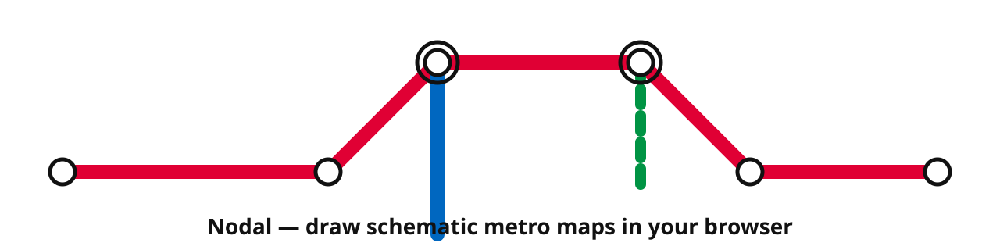

# Nodal

> Open-source transit-map editor. Vector-editor intuition, built for lines, stations, and interchanges.

**Nodal** is the product. **Linewright** is the monorepo (`linewright/` in
PROJECT.md). Free, MIT-licensed, runs in the browser, saves as open JSON.



## What it does (v0.3)

- Add, move, and delete stations on an SVG canvas
- Draw lines by dragging between stations
- Rounded corners, interchange / terminus symbols, line labels
- Shared tracks offset automatically (parallel lines)
- One-click label arrange to avoid overlap
- Multi-locale station names (English + 繁體中文) with a display-language switch
- Undo / redo, rename stations and lines, change line color
- Save and load JSON (schema v1), export SVG / PNG / PDF
- Fictional-city example so you can try everything safely

Try it: `pnpm install && pnpm dev` → http://localhost:5173

## Design principles

1. **Data model first.** UI is a view over `MetroMap`. `core` has zero UI deps.
2. **Every edit is a command.** Undo/redo works from day one.
3. **Open format.** JSON with `schemaVersion`. Git-friendly, documented in `packages/schema`.
4. **Transit-native.** Rounded corners, interchange glyphs, parallel offsets — not a generic vector tool.

## Architecture

```
packages/
  core/       # types, geometry, commands, validation (pure TS, no UI)
  renderer/   # MetroMap → SVG string (export) + path helpers
  app/        # React editor (Zustand store, toolbar, canvas, panels)
  schema/     # JSON Schema for MetroMap v1
apps/
  web/        # Vite entry — the browser editor
examples/
  lumen-city.json   # fictional city (trademark-safe)
```

See `docs/ARCHITECTURE.md`, `docs/brand-guidelines.md`, and `docs/TUTORIAL.md`.

## Contributing

See `CONTRIBUTING.md`. Short version: `pnpm install` → `pnpm dev`, run
`pnpm lint && pnpm test` before pushing, use Conventional Commits.

## Roadmap

- v0.1 — prototype: pan/zoom, stations, connect, 45° snap, SVG export, JSON save/load ✓
- v0.2 — undo/redo UI polish, property panels, rounded corners, interchanges ✓
- v0.3 — parallel-line offsets, label anti-overlap, multi-locale names, PNG/PDF export ✓
- v0.4 — Tauri desktop builds, published format spec, tutorials
- v1.0 — stable format, full docs, plugin API evaluation

Full plan: `PROJECT.md`.
