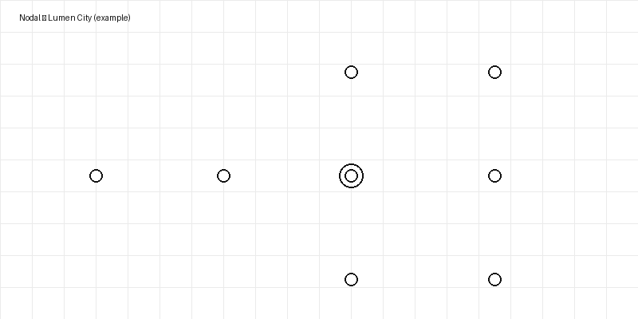

# Nodal

A browser-based editor for drawing schematic transit maps. You place stations, drag to connect them, and export.

Nodal is the app. The repo is called Linewright (that's just the monorepo name). MIT license. Maps save as JSON so you can put them in git.




## Run it

```
pnpm install
pnpm dev
```

Open http://localhost:5173

## What works right now

- Add, move, delete stations. Drag between them to draw lines.
- Lines get rounded corners. Shared stretches sit side by side on their own.
- Interchange stations show a ring, terminus a square.
- Labels move themselves out of each other's way (you can still move one by hand).
- Station names in English and Traditional Chinese, switchable from the panel.
- Undo/redo. Save and load JSON. Export SVG, PNG, or PDF.
- Comes with a made-up city (Lumen City) so you can play without breaking anything real.

## How it's put together

```
packages/
  core/       types, geometry, undoable commands, validation. No React in here.
  renderer/   turns a map into an SVG file.
  app/        the editor UI (React + Zustand)
  schema/     the JSON schema for the file format
apps/web/     the site you run locally
examples/     lumen-city.json
```

Notes are in `docs/`. Start at `docs/ARCHITECTURE.md` if you want the picture, or `docs/TUTORIAL.md` if you just want to draw something.

## Contributing

`CONTRIBUTING.md` has the steps we use. In short: fork, branch, `pnpm lint` and `pnpm test` before you push, and use Conventional Commits.

## Where this is headed

- 0.1, 0.2, 0.3 are in: editing, undo, panels, offsets, labels, languages, exports.
- Next up is the Tauri desktop build and polishing the docs. Full plan is in `PROJECT.md`.
